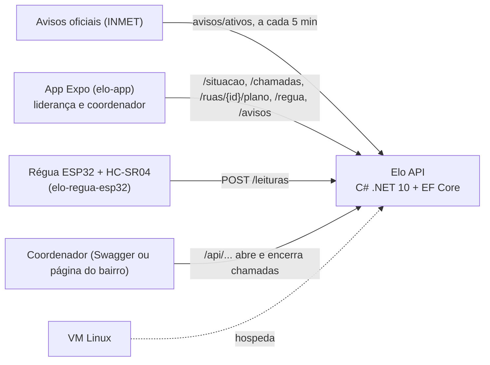
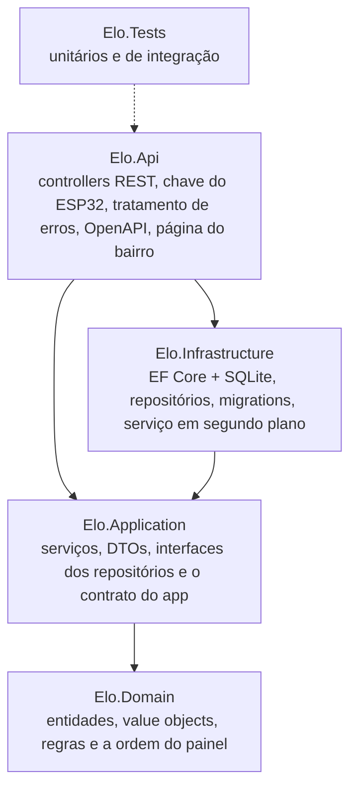
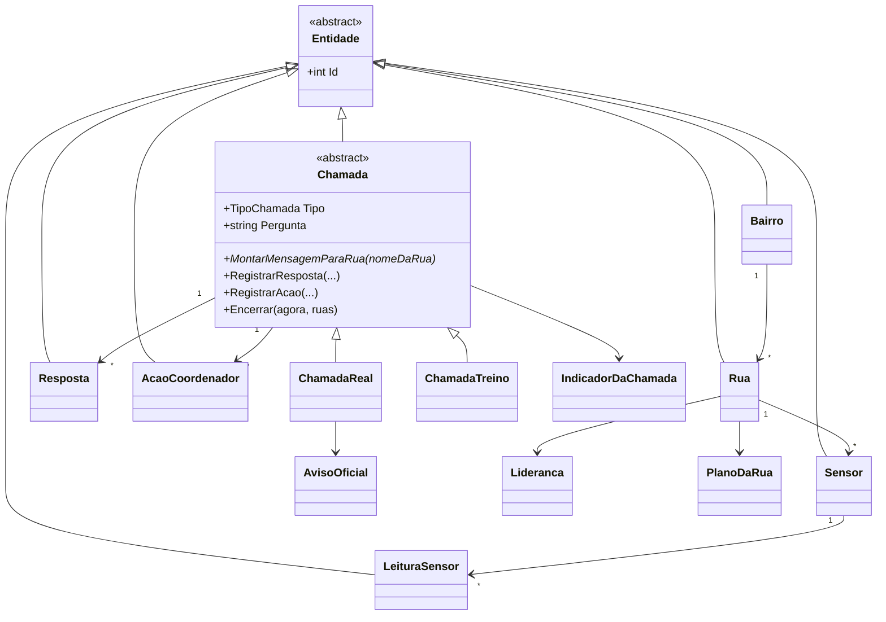

# Elo API (C# / .NET 10)

## Ficha da CitizenTech

| | |
|---|---|
| **Nome** | Elo (provisório) |
| **Cidade e bairro** | São Paulo. Bairro a definir; candidato: Jardim Pantanal |
| **Cidadão beneficiado** | Moradores de ruas que alagam, por meio da liderança da rua ou do voluntário do núcleo comunitário de Defesa Civil (NUPDEC) |
| **Problema, em uma frase** | Durante a chuva forte, quem cuida do bairro não consegue saber quais ruas estão bem, quais precisam de ajuda e quais ficaram em silêncio. |
| **Como funciona** | O aviso oficial chega, a liderança de cada rua responde em um toque, mesmo com internet ruim, e o coordenador vê as ruas sem resposta. Um sensor mede a água no ponto crítico. |
| **O que cada parte faz** | App: aviso, chamada, plano e registro. **API (este repositório): guarda as chamadas e ordena as ruas em silêncio.** ESP32: mede a água e toca o buzzer. ML: indica o nível de atenção por subprefeitura. Segurança: evita vazamento do que é digitado. Linux: hospeda a API. Testes: requisitos e casos de teste. |
| **Link do repositório** | https://github.com/Elo-Fiap/elo-api-csharp |
| **Indicador de impacto** | Percentual de ruas com situação conhecida em 15 minutos, comparando o simulado sem e com o app |
| **ODS conectados** | ODS 11 (meta 11.5) e ODS 13 (meta 13.1) |

## Integrantes

| Nome | RM |
|---|---|
| Bruno Leão | RM555563 |
| João Victor Franco | RM556790 |
| Lucca Borges | RM554608 |
| Rodrigo Jimenez | RM558148 |
| Ruan Melo | RM557599 |

---

## Sumário

- [O que é a API](#o-que-é-a-api)
- [Como executar](#como-executar)
- [Ligar o app e a régua (ESP32)](#ligar-o-app-e-a-régua-esp32)
- [Endpoints](#endpoints)
- [Arquitetura](#arquitetura)
- [Onde cada critério da avaliação aparece](#onde-cada-critério-da-avaliação-aparece)
- [Regras de negócio](#regras-de-negócio)
- [Evidências de funcionamento](#evidências-de-funcionamento)
- [Decisões e limitações](#decisões-e-limitações)
- [Uso de IA](#uso-de-ia)

## O que é a API

O alerta oficial avisa a cidade, mas ninguém fica sabendo quem está bem depois dele. No Elo, durante a chuva forte,
o coordenador do bairro abre uma **chamada**; a liderança de cada rua responde em um toque
(**Tudo bem**, **Água subindo** ou **Preciso de ajuda**), e o coordenador vê **primeiro quem pediu ajuda e depois quem ficou em silêncio**.

Esta API é o backend dessa ideia. Ela:

- guarda bairros, ruas, chamadas, respostas e ações do coordenador ("Vou até lá");
- **ordena as ruas com LINQ** para o painel do coordenador (quem pediu ajuda, depois quem está em silêncio, com a régua e o risco da rua pesando na ordem);
- calcula o **indicador de impacto** da proposta: percentual de ruas com situação conhecida em 15 minutos;
- recebe as leituras da **régua (ESP32)** e marca as que passam do limite;
- **fala a língua do app**: implementa as rotas do contrato do `elo-app` (`/situacao`, `/chamadas`, `/regua`, `/ruas/{id}/plano`, `/leituras` e `/avisos`);
- repassa os **avisos do INMET já filtrados pelo município**: baixa o Brasil inteiro em segundo plano e devolve ao celular só o que vale para a área (de cerca de 150 KB, ou mais de 580 KB em dias de muitos avisos, para uns 2 KB);
- aceita o **reenvio offline** das respostas sem duplicar (cada resposta tem um id gerado no celular);
- separa **chamada real** (motivada por um aviso oficial do INMET, porque o Elo não cria alerta próprio) de **treino** (simulado com prazo);
- protege a privacidade: mascara CPF, telefone e e-mail digitados na observação e **apaga as respostas depois de 30 dias**, guardando só o indicador.



> Todos os dados de exemplo são **simulados**: bairro "Jardim Pantanal (simulado)", 8 ruas em 3 microáreas,
> apelidos de lideranças e telefones fictícios (DDD 00, que não existe). Nada de dados pessoais reais.

## Como executar

**Pré-requisito:** [.NET 10 SDK](https://dotnet.microsoft.com/download/dotnet/10.0). Não precisa instalar banco: é SQLite.

```bash
dotnet run --project src/Elo.Api
```

Na primeira execução a API aplica as migrations, cria o arquivo `src/Elo.Api/elo.db` e cadastra os dados simulados
(uma chamada real aberta, um treino antigo e a régua `regua-exemplo`). Depois abra:

| Endereço | O que é |
|---|---|
| http://localhost:5080/swagger | Documentação e testes no **Swagger UI** |
| http://localhost:5080/scalar | A mesma documentação no **Scalar** |
| http://localhost:5080/openapi/v1.json | Documento OpenAPI 3.1 |
| http://localhost:5080/ | Página simples do resumo do bairro (para a VM de Sistemas Operacionais) |
| http://localhost:5080/health | Saúde da API e do banco |

O arquivo [`src/Elo.Api/Elo.Api.http`](src/Elo.Api/Elo.Api.http) tem o roteiro de requisições pronto para o Visual Studio, Rider ou VS Code (REST Client).
Para começar do zero, pare a API e apague `src/Elo.Api/elo.db`.

**Testes:**

```bash
dotnet test
```

**Migrations** (opcional, já estão no repositório):

```bash
dotnet tool restore
```

```bash
dotnet ef migrations add NomeDaMudanca --project src/Elo.Infrastructure --startup-project src/Elo.Api --output-dir Persistencia/Migrations
```

**Publicar na VM Linux** (o ESP32 no Wokwi só alcança endereço público):

```bash
dotnet publish src/Elo.Api -c Release -o publicar
```

```bash
ASPNETCORE_URLS=http://0.0.0.0:5080 Dispositivos__Chave=<chave-da-regua> dotnet publicar/Elo.Api.dll
```

## Ligar o app e a régua (ESP32)

**App (`elo-app`).** O app chama `EXPO_PUBLIC_API_URL` + `/situacao`, `/chamadas`, `/regua` e `/ruas/{id}/plano`.
Basta apontar para a API, sem `/api` no final:

```bash
EXPO_PUBLIC_API_URL=http://<ip-da-maquina>:5080
```

A resposta da liderança só entra se houver **chamada aberta** no bairro (o coordenador abre pelo Swagger:
`POST /api/bairros/1/chamadas`). Nos dados simulados já existe uma aberta. O bairro atendido pelas rotas do app é o
`ContratoDoApp:BairroId` do `appsettings.json` (o contrato diz que cada bairro do piloto tem a sua URL).

Para os avisos, o app pode trocar a chamada direta ao INMET por `GET /avisos?codigoIbge=<código da área>`.
A resposta já vem com os campos do tipo `Aviso` do app (`id`, `titulo`, `severidade`, `gravidade`, `inicio`, `fim`,
`quando`, `riscos`, `instrucoes`), filtrada e ordenada. Como a função `normalizarAvisos` do app espera o formato bruto do
INMET, o `inmet.ts` precisa de um ramo que use essa lista direto quando a API do bairro estiver configurada.

**Régua (`elo-regua-esp32`).** O `sketch.ino` manda `POST /leituras` com `{"reguaId":"regua-exemplo","nivelMetros":1.42}`
e o header `X-Chave-Dispositivo`. A `regua-exemplo` já vem cadastrada, com limite de 1,20 m como no firmware.
A chave **não fica no repositório**: configure por variável de ambiente (`Dispositivos__Chave`) ou `dotnet user-secrets`.
Sem chave configurada, só o ambiente de desenvolvimento aceita a leitura (para testar no Swagger).

## Endpoints

São 41 operações REST, todas assíncronas e documentadas no Swagger/Scalar.

### Rotas do contrato do app e do ESP32 (sem `/api`)

Seguem o [`docs/contrato-api.md`](https://github.com/Elo-Fiap/elo-app/blob/main/docs/contrato-api.md) do `elo-app`:
status `tudo_bem`, `agua_subindo`, `preciso_ajuda` (nulo = silêncio), ids em texto, datas no formato do `toISOString()` e medidas em metros.

| Método | Rota | O que faz |
|---|---|---|
| GET | `/situacao` | Situação do bairro na chamada atual, na ordem do painel (tela "Bairro" do app) |
| POST | `/chamadas` | Recebe a resposta da rua enviada pelo app (201; 200 se o mesmo `id` já tinha chegado) |
| GET | `/regua` | Última leitura da régua, em metros (`?reguaId=` opcional) |
| GET | `/ruas/{id}/plano` | Plano da rua com contatos de emergência (404 = rua sem plano) |
| GET | `/avisos?codigoIbge=` | Avisos do INMET que valem para o município, já filtrados e limpos (503 se o INMET estiver fora e não houver nada guardado) |
| POST | `/leituras` | Leitura do ESP32, com o header `X-Chave-Dispositivo` (204) |

### API completa (`/api`)

Nos dados simulados: bairro `1`, treino antigo = chamada `1`, chamada real aberta = chamada `2`.

| Método | Rota | O que faz |
|---|---|---|
| GET | `/api/bairros` | Lista os bairros, com total de ruas e a chamada aberta |
| POST | `/api/bairros` | Cadastra um bairro |
| GET / PUT / DELETE | `/api/bairros/{id}` | Detalha, atualiza ou exclui (409 se tiver chamadas) |
| GET | `/api/bairros/{id}/painel` | **Painel do coordenador** da chamada aberta, na ordem de prioridade |
| GET | `/api/bairros/{id}/indicadores` | Indicador de 15 minutos de cada chamada e média Real x Treino |
| GET | `/api/bairros/{bairroId}/ruas` | Ruas do bairro (filtros: `microarea`, `nivelRisco`, `incluirInativas`) |
| POST | `/api/bairros/{bairroId}/ruas` | Cadastra uma rua |
| GET / PUT / DELETE | `/api/ruas/{id}` | Detalha (com plano e sensores), atualiza ou exclui (409 se tiver histórico) |
| GET / PUT | `/api/ruas/{id}/plano` | Plano da rua: rota, encontro, abrigo e o que levar |
| GET | `/api/ruas/{id}/registro` | Respostas da rua agrupadas por mês |
| POST | `/api/bairros/{bairroId}/chamadas` | Abre chamada `Real` (com aviso oficial) ou `Treino` |
| GET | `/api/chamadas` | Lista com filtros (`bairroId`, `tipo`, `status`) e paginação |
| GET | `/api/chamadas/{id}` | Detalha uma chamada |
| POST | `/api/chamadas/{id}/encerramento` | Encerra e guarda a foto do indicador |
| GET | `/api/chamadas/{id}/painel` | Painel de qualquer chamada (aberta ou antiga) |
| GET | `/api/chamadas/{id}/registro` | Linha do tempo: o que foi avisado e o que foi feito |
| GET / POST | `/api/chamadas/{id}/respostas` | Lista (filtros `situacao`, `ruaId`) ou registra a resposta de uma rua |
| GET | `/api/chamadas/{id}/respostas/{respostaId}` | Detalha uma resposta |
| GET / POST | `/api/chamadas/{id}/acoes` | Lista ou registra ação do coordenador (`ContatoWhatsApp`, `Ligacao`, `VouAteLa`) |
| GET | `/api/chamadas/{id}/acoes/{acaoId}` | Detalha uma ação (é para cá que aponta o `Location` do 201) |
| GET / POST | `/api/sensores` | Lista (filtro `ruaId`) ou cadastra uma régua |
| GET / PUT / DELETE | `/api/sensores/{id}` | Detalha, atualiza ou exclui uma régua |
| GET / POST | `/api/sensores/{id}/leituras` | Lista as últimas leituras ou registra uma leitura (em cm) |
| GET | `/api/sensores/{id}/leituras/{leituraId}` | Detalha uma leitura (é para cá que aponta o `Location` do 201) |

Os detalhes de campos e fluxos estão em [`docs/contrato-api.md`](docs/contrato-api.md).

## Arquitetura

Arquitetura em camadas: cada projeto só conhece o de dentro, e a Aplicação depende de **interfaces**, nunca do EF Core.



```
elo-api-csharp/
├── Elo.sln
├── src/
│   ├── Elo.Domain/          Bairros, Ruas, Chamadas, Sensores, Painel, Comum
│   ├── Elo.Application/     Abstracoes (interfaces), ContratoDoApp, Avisos, serviços e DTOs por assunto
│   ├── Elo.Infrastructure/  Persistencia (DbContext, Configuracoes, Migrations), Repositorios, Avisos (INMET), Servicos
│   └── Elo.Api/             Controllers, Configuracao, wwwroot, Elo.Api.http
├── tests/Elo.Tests/         Unitarios/Dominio, Unitarios/Aplicacao, Integracao
└── docs/                    contrato-api.md e evidencias/
```

**Contrato do app como camada anticorrupção.** O app fala outra língua: para ele, "chamada" é o que a liderança responde,
o status é `preciso_ajuda` e o id da rua é texto. O [`ContratoDoAppService`](src/Elo.Application/ContratoDoApp/ContratoDoAppService.cs)
traduz isso para o domínio (a resposta entra na `Chamada` aberta do bairro), sem duplicar regra: tudo passa pelos mesmos
métodos de `Chamada`, `Resposta` e `Sensor`. O painel e o `/situacao` usam o mesmo [`MontadorDeSituacoes`](src/Elo.Application/Painel/MontadorDeSituacoes.cs).

**Avisos do INMET (padrão Decorator).** A Aplicação só conhece a interface `IFonteDeAvisos`. Na Infraestrutura, duas
classes implementam essa interface: o [`ClienteDoInmet`](src/Elo.Infrastructure/Avisos/ClienteDoInmet.cs) vai direto ao INMET
(o [`LeitorDeAvisosDoInmet`](src/Elo.Infrastructure/Avisos/LeitorDeAvisosDoInmet.cs) aplica as mesmas regras do `inmet.ts` do app)
e a [`FonteDeAvisosEmCache`](src/Elo.Infrastructure/Avisos/FonteDeAvisosEmCache.cs) embrulha o cliente e acrescenta o cache,
guardando a última lista boa. Quem pede `IFonteDeAvisos` recebe o cache sem saber disso. O
[`AtualizadorDeAvisosWorker`](src/Elo.Infrastructure/Avisos/AtualizadorDeAvisosWorker.cs) atualiza o cache a cada 5 minutos
pela interface `ICacheDeAvisos`, e o [`AvisoService`](src/Elo.Application/Avisos/AvisoService.cs) filtra pelo município com LINQ.

Modelo de domínio:



## Onde cada critério da avaliação aparece

### POO (3,0)

| Conceito | Onde |
|---|---|
| **Abstração e herança** | [`Entidade`](src/Elo.Domain/Comum/Entidade.cs) é a base de todas as entidades. [`Chamada`](src/Elo.Domain/Chamadas/Chamada.cs) é abstrata, com as subclasses [`ChamadaReal`](src/Elo.Domain/Chamadas/ChamadaReal.cs) e [`ChamadaTreino`](src/Elo.Domain/Chamadas/ChamadaTreino.cs) |
| **Polimorfismo** | `Tipo`, `Pergunta`, `MontarMensagemParaRua` e `DescreverAbertura` são abstratos, e `AvisoQueMotivou` e `DuracaoPrevistaEmMinutos` são virtuais: cada chamada responde do seu jeito (o treino avisa "TREINO" para ninguém confundir com alerta real). O painel, o link do WhatsApp, o registro e o DTO usam isso sem saber o tipo, sem `is` nem `as` |
| **Encapsulamento** | Setters privados, coleções expostas só para leitura (`IReadOnlyCollection` sobre lista privada), construtor `internal` de [`Resposta`](src/Elo.Domain/Chamadas/Resposta.cs): só a chamada cria respostas, depois de validar janela de tempo e bairro |
| **Value objects** | [`Lideranca`](src/Elo.Domain/Ruas/Lideranca.cs), [`PlanoDaRua`](src/Elo.Domain/Ruas/PlanoDaRua.cs), [`AvisoOficial`](src/Elo.Domain/Chamadas/AvisoOficial.cs) e [`IndicadorDaChamada`](src/Elo.Domain/Chamadas/IndicadorDaChamada.cs) são `record`s imutáveis, comparados por valor. No `PlanoDaRua`, a lista de itens é só leitura e entra na comparação (`Equals` e `GetHashCode` escritos à mão, porque o `record` compararia a lista por referência) |
| **Interfaces** | Repositórios ([`IRepository<T>`](src/Elo.Application/Abstracoes/IRepository.cs) genérico e os específicos), `IUnitOfWork`, uma interface por serviço, inclusive `IContratoDoAppService`, e `IFonteDeAvisos`, implementada pelo cliente do INMET e pelo cache que o embrulha (Decorator) |
| **Generics** | `IRepository<T> where T : Entidade`, [`RepositoryBase<T>`](src/Elo.Infrastructure/Repositorios/RepositoryBase.cs), `PaginaResultado<T>`, `ResultadoDeRegistro<T>` |

### Web API (2,5)

- Controllers REST em [`src/Elo.Api/Controllers`](src/Elo.Api/Controllers) com `[ApiController]`, rotas por recurso e sub-recurso, verbos corretos e códigos 200, 201 (com `Location` apontando para o recurso criado), 204, 400, 401, 404, 409 e 422.
- **Rotas do contrato do app** ([`ContratoDoAppController`](src/Elo.Api/Controllers/ContratoDoAppController.cs)) no formato que o `elo-app` e o ESP32 já usam.
- DTOs de entrada e saída separados das entidades (a API nunca expõe entidade), com validação por DataAnnotations e mensagens em português.
- Erros padronizados em ProblemDetails (RFC 9457) pelo [`TratadorGlobalDeExcecoes`](src/Elo.Api/Configuracao/TratadorGlobalDeExcecoes.cs): os controllers não têm `try/catch`.
- Filtro de autorização [`ExigeChaveDeDispositivo`](src/Elo.Api/Configuracao/ChaveDeDispositivo.cs): confere o header do ESP32 em tempo constante, antes de qualquer outra coisa.
- Documentação OpenAPI 3.1 gerada pelo ASP.NET Core, com os comentários `///` virando descrição, exibida no **Swagger UI** e no **Scalar** ([`DocumentacaoDaApi`](src/Elo.Api/Configuracao/DocumentacaoDaApi.cs)).
- Paginação, filtros por query string, idempotência no reenvio offline, health check e CORS para o app.

### EF Core + LINQ (1,5)

- [`EloDbContext`](src/Elo.Infrastructure/Persistencia/EloDbContext.cs) com Fluent API em classes `IEntityTypeConfiguration` ([`Configuracoes`](src/Elo.Infrastructure/Persistencia/Configuracoes)).
- **Herança TPH**: `ChamadaReal` e `ChamadaTreino` na tabela `Chamadas`, com a coluna `Discriminador`.
- **Owned types** para os value objects, **coleção primitiva** (lista do plano salva em JSON), enums gravados como texto, conversor de datas para UTC.
- **Índice único filtrado** que garante no banco uma chamada aberta por bairro, e índice único no id local das respostas.
- [Migrations](src/Elo.Infrastructure/Persistencia/Migrations) aplicadas sozinhas na inicialização. A segunda registra a adaptação ao contrato do app (id local em texto e observação de até 200 caracteres) e não gera SQL: no SQLite essas colunas já eram `TEXT` e o tamanho máximo não é aplicado pelo banco, então só o modelo mudou.
- LINQ em vários níveis:
  - [`PriorizadorDeRuas`](src/Elo.Domain/Painel/PriorizadorDeRuas.cs): `Where`, `OrderBy`/`ThenBy`/`ThenByDescending` e concatenação: **é o LINQ que ordena as ruas em silêncio**;
  - [`IndicadorDaChamada`](src/Elo.Domain/Chamadas/IndicadorDaChamada.cs): `GroupBy`, `Min`, `Any`, `Count`, `Average`;
  - [`SensorRepository`](src/Elo.Infrastructure/Repositorios/SensorRepository.cs): `SelectMany`, subconsulta com `OrderByDescending().FirstOrDefault()`, `MaxBy` e **query syntax com dois `join`**;
  - [`BairroRepository`](src/Elo.Infrastructure/Repositorios/BairroRepository.cs): projeção direto para DTO com subconsultas;
  - [`ChamadaRepository`](src/Elo.Infrastructure/Repositorios/ChamadaRepository.cs): filtros montados aos poucos, filtro por subclasse (`is ChamadaReal`), a janela da chamada traduzida para SQL, `Skip`/`Take`, `ExecuteDeleteAsync`;
  - [`LinhaDoTempo`](src/Elo.Application/Chamadas/LinhaDoTempo.cs): `Concat` de eventos de origens diferentes, `MinBy`, `OrderBy`;
  - [`MontadorDeSituacoes`](src/Elo.Application/Painel/MontadorDeSituacoes.cs) e [`PainelService`](src/Elo.Application/Painel/PainelService.cs): `ToLookup`, `Sum`, `GroupBy` para a média por tipo;
  - [`AvisoService`](src/Elo.Application/Avisos/AvisoService.cs): `Where`, `DistinctBy`, `OrderByDescending`/`ThenBy` sobre os avisos do INMET.

### Programação assíncrona (1,0)

- `async`/`await` de ponta a ponta: controller → serviço → repositório → EF Core (`ToListAsync`, `FirstOrDefaultAsync`, `SaveChangesAsync`, `ExecuteDeleteAsync`), com `CancellationToken` repassado em todas as camadas.
- [`RetencaoWorker`](src/Elo.Infrastructure/Servicos/RetencaoWorker.cs): `BackgroundService` com `PeriodicTimer` que roda a [rotina de privacidade](src/Elo.Application/Retencao/RetencaoService.cs) sem travar a API, criando um escopo de DI por execução.
- Inicialização assíncrona do banco (`MigrateAsync` e carga dos dados simulados) antes de a API aceitar requisições.
- Avisos do INMET: `HttpClient` criado pelo `IHttpClientFactory`, resposta lida em fluxo (`JsonDocument.ParseAsync`), um
  `SemaphoreSlim` para só uma requisição baixar por vez e o [`AtualizadorDeAvisosWorker`](src/Elo.Infrastructure/Avisos/AtualizadorDeAvisosWorker.cs)
  (outro `BackgroundService` com `PeriodicTimer`), para o `GET /avisos` responder na hora sem esperar o INMET.

### Qualidade do código (2,0)

- Camadas com dependências apontando para dentro; injeção de dependência em tudo (inclusive o relógio, via `TimeProvider`, para testar o tempo).
- Regras de negócio no domínio, validação de entrada na borda, camada anticorrupção para o contrato do app, erros padronizados, logs estruturados **sem dado sensível** (a observação nunca vai para o log).
- Build sem nenhum aviso. Nomes do domínio em português, iguais aos da proposta (chamada, rua em silêncio, "Vou até lá").
- **154 testes automatizados** ([`tests/Elo.Tests`](tests/Elo.Tests)), nenhum depende de internet:
  - 54 unitários do domínio (polimorfismo, janela de tempo, offline, indicador, ordem do painel, mascaramento, value objects);
  - 36 unitários da aplicação: serviços com **Moq** e relógio falso (`FakeTimeProvider`), a tradução para o formato do app e o filtro de avisos;
  - 19 unitários da infraestrutura: a leitura da resposta do INMET (com o mesmo fixture e os mesmos casos de borda dos testes do app), o cache e a ligação do Decorator na injeção de dependência;
  - 45 de integração com a API inteira (`WebApplicationFactory`) e um banco SQLite temporário por classe, incluindo as rotas do contrato, a chave do ESP32, o `/avisos` com um INMET falso e o `Location` de cada 201.

## Regras de negócio

| Regra | Onde |
|---|---|
| Chamada real só existe com aviso oficial (o Elo não cria alerta próprio) | `ChamadaReal` |
| Treino dura de 5 a 180 minutos (padrão 30) e termina sozinho | `ChamadaTreino` |
| Só uma chamada aberta por bairro (no serviço e no banco) | `ChamadaService` + índice filtrado |
| A quantidade de pessoas é opcional (o contrato do app permite nulo); quando vem, vai de 1 a 500 | `Resposta` |
| Observação de até 200 caracteres, com CPF, telefone e e-mail mascarados | `Resposta`, `FiltroDeDadosPessoais` |
| Resposta vale se foi **dada** dentro da janela da chamada, mesmo chegando depois (offline) | `Chamada.AceitaRespostaDadaEm` |
| Resposta enviada pelo app entra na chamada do bairro aberta na hora do `criadaEm`; sem chamada, 422 | `ContratoDoAppService` |
| Mesmo id local reenviado devolve a resposta salva (200), sem duplicar | `RespostaService`, `ContratoDoAppService` + índice único |
| A resposta mais recente da rua é a que vale no painel | `SituacaoDaRua` |
| "Vou até lá" só conta se foi marcado depois da última resposta da rua | `SituacaoDaRua` |
| Ordem do painel: ajuda (sem ninguém a caminho, depois quem espera há mais tempo) → silêncio (régua acima do limite, depois risco da rua) → água subindo → tudo bem | `PriorizadorDeRuas` |
| Indicador conta a hora em que a resposta **chegou**, não a hora do toque | `IndicadorDaChamada` |
| Leitura da régua no limite ou acima vira alerta; guarda o limite que valia na hora | `Sensor`, `LeituraSensor` |
| O ESP32 só grava leitura com a chave do dispositivo | `ExigeChaveDeDispositivo` |
| Aviso do INMET vale para o município só pelo código IBGE inteiro (nunca por prefixo); encerrados saem; o mesmo aviso não se repete em "hoje" e "futuro"; ordem por gravidade e início | `AvisoDoInmet`, `AvisoService` |
| Com o INMET fora do ar, vale a última lista baixada; sem nenhuma, 503 | `FonteDeAvisosEmCache` |
| Respostas com mais de 30 dias são apagadas; o indicador fica guardado na chamada | `RetencaoService` |
| Rua com histórico não é excluída (é desativada); bairro com chamadas não é excluído | `RuaService`, `BairroService` |

## Evidências de funcionamento

- [`docs/evidencias/fluxo-completo.md`](docs/evidencias/fluxo-completo.md): 27 requisições reais feitas contra a API rodando, em quatro partes: a API completa (painel antes e depois, reenvio offline, erros 400/404/409/422), as **rotas do contrato do app e do ESP32** (`/situacao`, `/chamadas`, `/leituras` com 401 sem chave e 204 com chave, `/regua`, `/ruas/{id}/plano`), o fim da chamada com o indicador e os **avisos reais do INMET** (148.353 bytes do INMET viraram 2.333 bytes para o município).
- [`docs/evidencias/resultado-dos-testes.txt`](docs/evidencias/resultado-dos-testes.txt): os 154 testes aprovados.

**Página do resumo do bairro** (a régua mostra o indicador de 15 minutos; ruas em silêncio têm o marcador vazado):


**Swagger UI:**


**Scalar:**


## Decisões e limitações

- **SQLite** para quem avaliar rodar sem instalar banco. Trocar para Oracle ou SQL Server muda só o provedor no `AddInfrastructure` e as migrations.
- **Sem login de usuário** nesta versão, como no contrato do app ("o app não faz login"). O ESP32 usa uma chave; hoje é **uma chave para todos os dispositivos**. O próximo passo seria uma chave por régua e login do coordenador.
- **Datas em UTC** na API; o app converte para o horário local.
- O `GET /avisos` já filtra o INMET no servidor, como o contrato recomenda, mas o app ainda busca o INMET direto até ganhar o ramo que lê a lista pronta (veja [Ligar o app e a régua](#ligar-o-app-e-a-régua-esp32)).
- Sem internet no servidor, o `/avisos` devolve 503; o resto da API funciona normalmente. O INMET não publica um contrato dessa API, então o leitor aceita as variações já vistas (listas em texto do Python, `encerrado` como texto).
- O `bateriaPercentual` do ESP32 é aceito, mas não é guardado (a régua simulada não tem bateria).
- Sem chamada aberta, `POST /chamadas` devolve 422 e o app deixa a resposta pendente para tentar de novo. Abrir a chamada é papel do coordenador (`/api/bairros/{id}/chamadas`).
- O mascaramento acha CPF, telefone e e-mail; nomes e doenças ficam com o módulo de Cybersecurity da CitizenTech.

## Uso de IA

A API foi feita com ajuda de IA (Claude Code). Os prompts, as perguntas feitas e o que precisa ser revisado pela equipe estão em [`prompts.md`](prompts.md).
