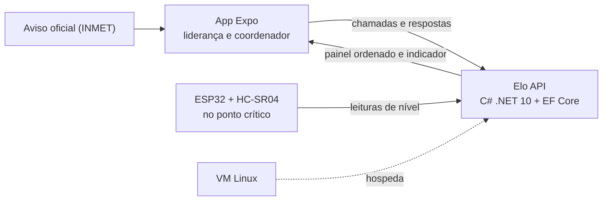
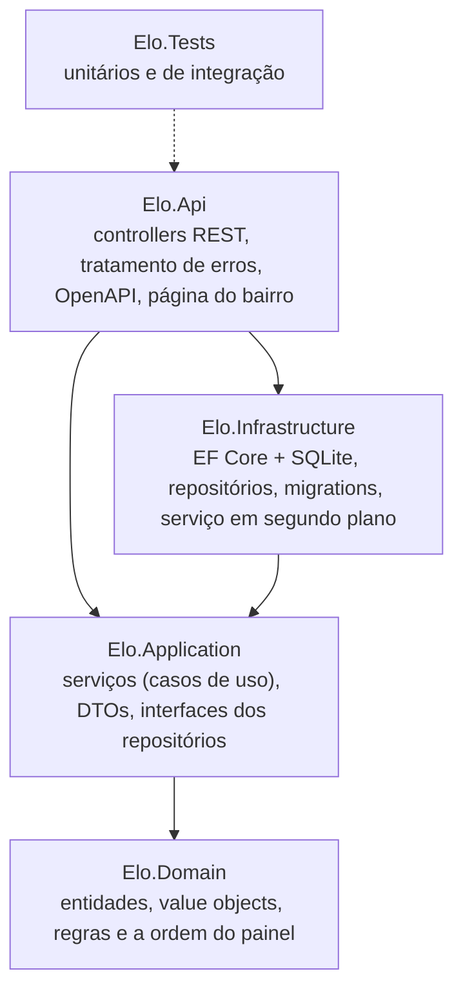
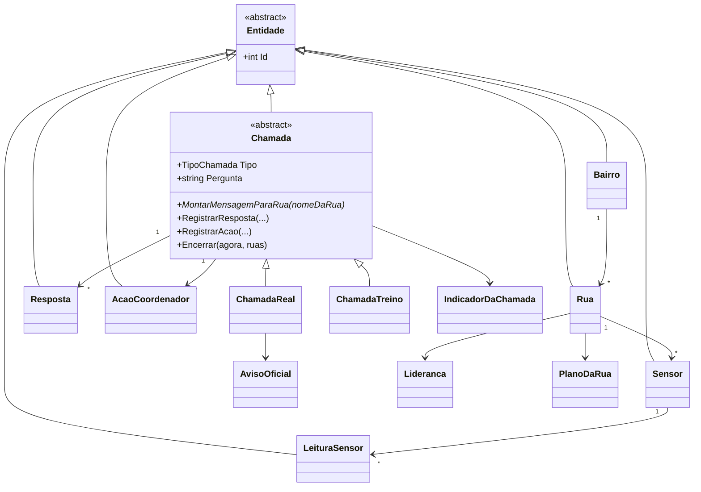
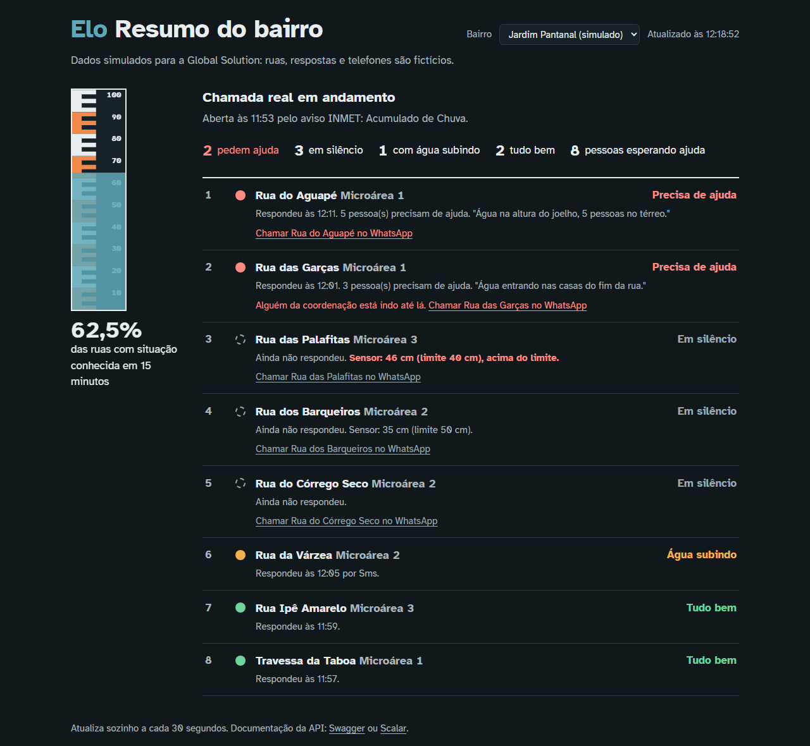
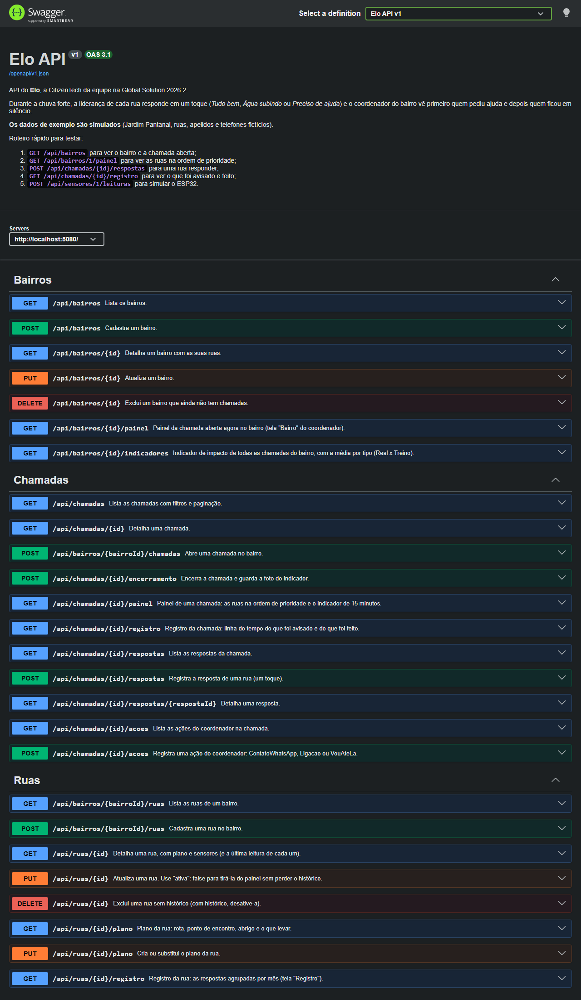
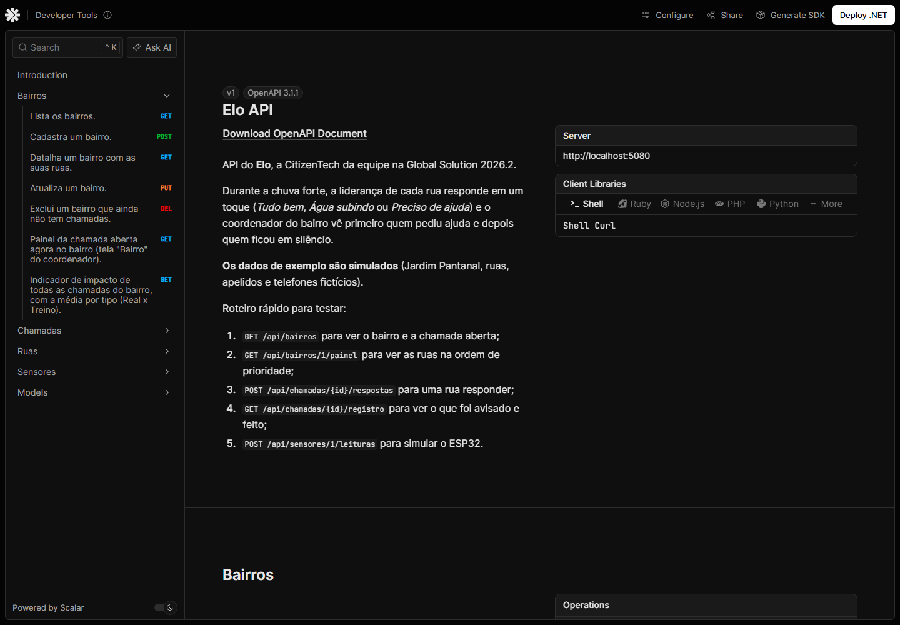

# Elo API (C# / .NET 10)

## Ficha da CitizenTech

| | |
|---|---|
| **Nome** | Elo (provisório) |
| **Cidade e bairro** | São Paulo. Bairro a definir; candidato: Jardim Pantanal |
| **Cidadão beneficiado** | Moradores de ruas que alagam, por meio da liderança da rua ou do voluntário do núcleo comunitário de Defesa Civil (NUPDEC) |
| **Problema, em uma frase** | Durante a chuva forte, quem cuida do bairro não consegue saber quais ruas estão bem, quais precisam de ajuda e quais ficaram em silêncio. |
| **Como funciona** | O aviso oficial chega, a liderança de cada rua responde em um toque, mesmo com internet ruim, e o coordenador vê as ruas sem resposta. Um sensor mede a água no ponto crítico. |
| **O que cada parte faz** | App: aviso, chamada, plano e registro. **API (este repositório): guarda as chamadas e ordena as ruas em silêncio.** ESP32: mede a água e toca o buzzer. ML: indica o nível de atenção por subprefeitura. Segurança: evita vazamento do que é digitado. Linux: hospeda a API. Testes: requisitos e casos de teste. |
| **Link do repositório** | https://github.com/Elo-Fiap/elo-api-csharp |
| **Indicador de impacto** | Percentual de ruas com situação conhecida em 15 minutos, comparando o simulado sem e com o app |
| **ODS conectados** | ODS 11 (meta 11.5) e ODS 13 (meta 13.1) |

## Integrantes

| Nome | RM |
|---|---|
| Bruno Leão | RM555563 |
| João Victor Franco | RM556790 |
| Lucca Borges | RM554608 |
| Rodrigo Jimenez | RM558148 |
| Ruan Melo | RM557599 |

---

## Sumário

- [O que é a API](#o-que-é-a-api)
- [Como executar](#como-executar)
- [Endpoints](#endpoints)
- [Arquitetura](#arquitetura)
- [Onde cada critério da avaliação aparece](#onde-cada-critério-da-avaliação-aparece)
- [Regras de negócio](#regras-de-negócio)
- [Evidências de funcionamento](#evidências-de-funcionamento)
- [Decisões e limitações](#decisões-e-limitações)
- [Uso de IA](#uso-de-ia)

## O que é a API

O alerta oficial avisa a cidade, mas ninguém fica sabendo quem está bem depois dele. No Elo, durante a chuva forte,
o coordenador do bairro abre uma **chamada**; a liderança de cada rua responde em um toque
(**Tudo bem**, **Água subindo** ou **Preciso de ajuda**), e o coordenador vê **primeiro quem pediu ajuda e depois quem ficou em silêncio**.

Esta API é o backend dessa ideia. Ela:

- guarda bairros, ruas, chamadas, respostas e ações do coordenador ("Vou até lá");
- **ordena as ruas com LINQ** para o painel do coordenador (quem pediu ajuda, depois quem está em silêncio, com o sensor e o risco da rua pesando na ordem);
- calcula o **indicador de impacto** da proposta: percentual de ruas com situação conhecida em 15 minutos;
- recebe as leituras do **ESP32** (nível da água) e marca as que passam do limite;
- aceita o **reenvio offline** das respostas sem duplicar (cada resposta tem um `idLocal` gerado no celular);
- separa **chamada real** (motivada por um aviso oficial do INMET, porque o Elo não cria alerta próprio) de **treino** (simulado com prazo);
- protege a privacidade: mascara CPF, telefone e e-mail digitados na observação e **apaga as respostas depois de 30 dias**, guardando só o indicador.



> Todos os dados de exemplo são **simulados**: bairro "Jardim Pantanal (simulado)", 8 ruas em 3 microáreas,
> apelidos de lideranças e telefones fictícios (DDD 00, que não existe). Nada de dados pessoais reais.

## Como executar

**Pré-requisito:** [.NET 10 SDK](https://dotnet.microsoft.com/download/dotnet/10.0). Não precisa instalar banco: é SQLite.

```bash
dotnet run --project src/Elo.Api
```

Na primeira execução a API aplica as migrations, cria o arquivo `src/Elo.Api/elo.db` e cadastra os dados simulados
(uma chamada real aberta e um treino antigo). Depois abra:

| Endereço | O que é |
|---|---|
| http://localhost:5080/swagger | Documentação e testes no **Swagger UI** |
| http://localhost:5080/scalar | A mesma documentação no **Scalar** |
| http://localhost:5080/openapi/v1.json | Documento OpenAPI 3.1 |
| http://localhost:5080/ | Página simples do resumo do bairro (para a VM de Sistemas Operacionais) |
| http://localhost:5080/health | Saúde da API e do banco |

O arquivo [`src/Elo.Api/Elo.Api.http`](src/Elo.Api/Elo.Api.http) tem o roteiro de requisições pronto para o Visual Studio, Rider ou VS Code (REST Client).
Para começar do zero, pare a API e apague `src/Elo.Api/elo.db`.

**Testes:**

```bash
dotnet test
```

**Migrations** (opcional, já estão no repositório):

```bash
dotnet tool restore
```

```bash
dotnet ef migrations add NomeDaMudanca --project src/Elo.Infrastructure --startup-project src/Elo.Api --output-dir Persistencia/Migrations
```

**Publicar na VM Linux** (o ESP32 no Wokwi só alcança endereço público):

```bash
dotnet publish src/Elo.Api -c Release -o publicar
```

```bash
ASPNETCORE_URLS=http://0.0.0.0:5080 dotnet publicar/Elo.Api.dll
```

## Endpoints

São 33 operações REST, todas assíncronas e documentadas no Swagger/Scalar. Nos dados simulados: bairro `1`, treino antigo = chamada `1`, chamada real aberta = chamada `2`.

| Método | Rota | O que faz |
|---|---|---|
| GET | `/api/bairros` | Lista os bairros, com total de ruas e a chamada aberta |
| POST | `/api/bairros` | Cadastra um bairro |
| GET / PUT / DELETE | `/api/bairros/{id}` | Detalha, atualiza ou exclui (409 se tiver chamadas) |
| GET | `/api/bairros/{id}/painel` | **Painel do coordenador** da chamada aberta, na ordem de prioridade |
| GET | `/api/bairros/{id}/indicadores` | Indicador de 15 minutos de cada chamada e média Real x Treino |
| GET | `/api/bairros/{bairroId}/ruas` | Ruas do bairro (filtros: `microarea`, `nivelRisco`, `incluirInativas`) |
| POST | `/api/bairros/{bairroId}/ruas` | Cadastra uma rua |
| GET / PUT / DELETE | `/api/ruas/{id}` | Detalha (com plano e sensores), atualiza ou exclui (409 se tiver histórico) |
| GET / PUT | `/api/ruas/{id}/plano` | Plano da rua: rota, encontro, abrigo e o que levar |
| GET | `/api/ruas/{id}/registro` | Respostas da rua agrupadas por mês |
| POST | `/api/bairros/{bairroId}/chamadas` | Abre chamada `Real` (com aviso oficial) ou `Treino` |
| GET | `/api/chamadas` | Lista com filtros (`bairroId`, `tipo`, `status`) e paginação |
| GET | `/api/chamadas/{id}` | Detalha uma chamada |
| POST | `/api/chamadas/{id}/encerramento` | Encerra e guarda a foto do indicador |
| GET | `/api/chamadas/{id}/painel` | Painel de qualquer chamada (aberta ou antiga) |
| GET | `/api/chamadas/{id}/registro` | Linha do tempo: o que foi avisado e o que foi feito |
| GET / POST | `/api/chamadas/{id}/respostas` | Lista (filtros `situacao`, `ruaId`) ou registra a resposta de uma rua |
| GET | `/api/chamadas/{id}/respostas/{respostaId}` | Detalha uma resposta |
| GET / POST | `/api/chamadas/{id}/acoes` | Lista ou registra ação do coordenador (`ContatoWhatsApp`, `Ligacao`, `VouAteLa`) |
| GET / POST | `/api/sensores` | Lista (filtro `ruaId`) ou cadastra sensor ESP32 |
| GET / PUT / DELETE | `/api/sensores/{id}` | Detalha, atualiza ou exclui sensor |
| GET / POST | `/api/sensores/{id}/leituras` | Lista as últimas leituras ou recebe leitura do ESP32 |

O contrato para quem faz o app e o ESP32 (campos, fluxo offline e exemplo em Arduino) está em [`docs/contrato-api.md`](docs/contrato-api.md).

## Arquitetura

Arquitetura em camadas: cada projeto só conhece o de dentro, e a Aplicação depende de **interfaces**, nunca do EF Core.



```
gs-sharp/
├── Elo.sln
├── src/
│   ├── Elo.Domain/          Bairros, Ruas, Chamadas, Sensores, Painel, Comum
│   ├── Elo.Application/     Abstracoes (interfaces), serviços e DTOs por assunto
│   ├── Elo.Infrastructure/  Persistencia (DbContext, Configuracoes, Migrations), Repositorios, Servicos
│   └── Elo.Api/             Controllers, Configuracao, wwwroot, Elo.Api.http
├── tests/Elo.Tests/         Unitarios/Dominio, Unitarios/Aplicacao, Integracao
└── docs/                    contrato-api.md e evidencias/
```

Modelo de domínio:



## Onde cada critério da avaliação aparece

### POO (3,0)

| Conceito | Onde |
|---|---|
| **Abstração e herança** | [`Entidade`](src/Elo.Domain/Comum/Entidade.cs) é a base de todas as entidades. [`Chamada`](src/Elo.Domain/Chamadas/Chamada.cs) é abstrata, com as subclasses [`ChamadaReal`](src/Elo.Domain/Chamadas/ChamadaReal.cs) e [`ChamadaTreino`](src/Elo.Domain/Chamadas/ChamadaTreino.cs) |
| **Polimorfismo** | `Tipo`, `Pergunta` e `MontarMensagemParaRua` são abstratos: cada chamada responde do seu jeito (o treino avisa "TREINO" para ninguém confundir com alerta real). O painel e o link do WhatsApp usam isso sem saber o tipo |
| **Encapsulamento** | Setters privados, coleções expostas só para leitura (`IReadOnlyCollection` sobre lista privada), construtor `internal` de [`Resposta`](src/Elo.Domain/Chamadas/Resposta.cs): só a chamada cria respostas, depois de validar janela de tempo e bairro |
| **Value objects** | [`Lideranca`](src/Elo.Domain/Ruas/Lideranca.cs), [`PlanoDaRua`](src/Elo.Domain/Ruas/PlanoDaRua.cs), [`AvisoOficial`](src/Elo.Domain/Chamadas/AvisoOficial.cs) e [`IndicadorDaChamada`](src/Elo.Domain/Chamadas/IndicadorDaChamada.cs) são `record`s imutáveis, comparados por valor |
| **Interfaces** | Repositórios ([`IRepository<T>`](src/Elo.Application/Abstracoes/IRepository.cs) genérico e os específicos), `IUnitOfWork` e uma interface por serviço |
| **Generics** | `IRepository<T> where T : Entidade`, [`RepositoryBase<T>`](src/Elo.Infrastructure/Repositorios/RepositoryBase.cs), `PaginaResultado<T>`, `ResultadoDeRegistro<T>` |

### Web API (2,5)

- Controllers REST em [`src/Elo.Api/Controllers`](src/Elo.Api/Controllers) com `[ApiController]`, rotas por recurso e sub-recurso, verbos corretos e códigos 200, 201 (com `Location`), 204, 400, 404, 409 e 422.
- DTOs de entrada e saída separados das entidades (a API nunca expõe entidade), com validação por DataAnnotations e mensagens em português.
- Erros padronizados em ProblemDetails (RFC 9457) pelo [`TratadorGlobalDeExcecoes`](src/Elo.Api/Configuracao/TratadorGlobalDeExcecoes.cs): os controllers não têm `try/catch`.
- Documentação OpenAPI 3.1 gerada pelo ASP.NET Core, com os comentários `///` virando descrição, exibida no **Swagger UI** e no **Scalar** ([`DocumentacaoDaApi`](src/Elo.Api/Configuracao/DocumentacaoDaApi.cs)).
- Paginação, filtros por query string, idempotência no reenvio offline, health check e CORS para o app.

### EF Core + LINQ (1,5)

- [`EloDbContext`](src/Elo.Infrastructure/Persistencia/EloDbContext.cs) com Fluent API em classes `IEntityTypeConfiguration` ([`Configuracoes`](src/Elo.Infrastructure/Persistencia/Configuracoes)).
- **Herança TPH**: `ChamadaReal` e `ChamadaTreino` na tabela `Chamadas`, com a coluna `Discriminador`.
- **Owned types** para os value objects, **coleção primitiva** (lista do plano salva em JSON), enums gravados como texto, conversor de datas para UTC.
- **Índice único filtrado** que garante no banco uma chamada aberta por bairro, e índice único no `IdLocal` das respostas.
- [Migration inicial](src/Elo.Infrastructure/Persistencia/Migrations) aplicada sozinha na inicialização.
- LINQ em vários níveis:
  - [`PriorizadorDeRuas`](src/Elo.Domain/Painel/PriorizadorDeRuas.cs): `Where`, `OrderBy`/`ThenBy`/`ThenByDescending` e concatenação: **é o LINQ que ordena as ruas em silêncio**;
  - [`IndicadorDaChamada`](src/Elo.Domain/Chamadas/IndicadorDaChamada.cs): `GroupBy`, `Min`, `Any`, `Count`, `Average`;
  - [`SensorRepository`](src/Elo.Infrastructure/Repositorios/SensorRepository.cs): `SelectMany`, subconsulta com `OrderByDescending().FirstOrDefault()` e **query syntax com dois `join`**;
  - [`BairroRepository`](src/Elo.Infrastructure/Repositorios/BairroRepository.cs): projeção direto para DTO com subconsultas;
  - [`ChamadaRepository`](src/Elo.Infrastructure/Repositorios/ChamadaRepository.cs): filtros montados aos poucos, filtro por subclasse (`is ChamadaReal`), `Skip`/`Take`, `ExecuteDeleteAsync`;
  - [`LinhaDoTempo`](src/Elo.Application/Chamadas/LinhaDoTempo.cs): `Concat` de eventos de origens diferentes, `MinBy`, `OrderBy`;
  - [`PainelService`](src/Elo.Application/Painel/PainelService.cs): `ToLookup`, `Sum`, `GroupBy` para a média por tipo.

### Programação assíncrona (1,0)

- `async`/`await` de ponta a ponta: controller → serviço → repositório → EF Core (`ToListAsync`, `FirstOrDefaultAsync`, `SaveChangesAsync`, `ExecuteDeleteAsync`), com `CancellationToken` repassado em todas as camadas.
- [`RetencaoWorker`](src/Elo.Infrastructure/Servicos/RetencaoWorker.cs): `BackgroundService` com `PeriodicTimer` que roda a [rotina de privacidade](src/Elo.Application/Retencao/RetencaoService.cs) sem travar a API, criando um escopo de DI por execução.
- Inicialização assíncrona do banco (`MigrateAsync` e carga dos dados simulados) antes de a API aceitar requisições.

### Qualidade do código (2,0)

- Camadas com dependências apontando para dentro; injeção de dependência em tudo (inclusive o relógio, via `TimeProvider`, para testar o tempo).
- Regras de negócio no domínio, validação de entrada na borda, erros padronizados, logs estruturados **sem dado sensível** (a observação nunca vai para o log).
- Build sem nenhum aviso. Nomes do domínio em português, iguais aos da proposta (chamada, rua em silêncio, "Vou até lá").
- **83 testes automatizados** ([`tests/Elo.Tests`](tests/Elo.Tests)):
  - 48 unitários do domínio (polimorfismo, janela de tempo, offline, indicador, ordem do painel, mascaramento);
  - 15 unitários dos serviços com **Moq** e relógio falso (`FakeTimeProvider`);
  - 20 de integração com a API inteira (`WebApplicationFactory`) e um banco SQLite temporário por classe.

## Regras de negócio

| Regra | Onde |
|---|---|
| Chamada real só existe com aviso oficial (o Elo não cria alerta próprio) | `ChamadaReal` |
| Treino dura de 5 a 180 minutos (padrão 30) e termina sozinho | `ChamadaTreino` |
| Só uma chamada aberta por bairro (no serviço e no banco) | `ChamadaService` + índice filtrado |
| "Preciso de ajuda" exige a quantidade de pessoas; as outras situações não aceitam | `Resposta` |
| Resposta vale se foi **dada** dentro da janela da chamada, mesmo chegando depois (offline) | `Chamada.AceitaRespostaDadaEm` |
| Mesmo `idLocal` reenviado devolve a resposta salva (200), sem duplicar | `RespostaService` + índice único |
| A resposta mais recente da rua é a que vale no painel | `SituacaoDaRua` |
| "Vou até lá" só conta se foi marcado depois da última resposta da rua | `SituacaoDaRua` |
| Ordem do painel: ajuda (sem ninguém a caminho, depois quem espera há mais tempo) → silêncio (sensor acima do limite, depois risco da rua) → água subindo → tudo bem | `PriorizadorDeRuas` |
| Indicador conta a hora em que a resposta **chegou**, não a hora do toque | `IndicadorDaChamada` |
| CPF, telefone e e-mail digitados na observação são mascarados | `FiltroDeDadosPessoais` |
| Respostas com mais de 30 dias são apagadas; o indicador fica guardado na chamada | `RetencaoService` |
| Rua com histórico não é excluída (é desativada); bairro com chamadas não é excluído | `RuaService`, `BairroService` |
| Leitura do sensor no limite ou acima vira alerta; guarda o limite que valia na hora | `Sensor`, `LeituraSensor` |

## Evidências de funcionamento

- [`docs/evidencias/fluxo-completo.md`](docs/evidencias/fluxo-completo.md): 16 requisições reais feitas contra a API rodando (painel antes e depois, reenvio offline, erros 400/404/409/422, sensor, encerramento, treino e indicadores).
- [`docs/evidencias/resultado-dos-testes.txt`](docs/evidencias/resultado-dos-testes.txt): os 83 testes aprovados.

**Página do resumo do bairro** (a régua mostra o indicador de 15 minutos; ruas em silêncio têm o marcador vazado):



**Swagger UI:**



**Scalar:**



## Decisões e limitações

- **SQLite** para quem avaliar rodar sem instalar banco. Trocar para Oracle ou SQL Server muda só o provedor no `AddInfrastructure` e as migrations.
- **Sem autenticação** nesta versão: o foco da matéria é a API. O próximo passo seria login do coordenador (JWT) e uma chave por sensor.
- **Datas em UTC** na API; o app converte para o horário local.
- A API não busca avisos do INMET sozinha: o app já faz isso e manda a referência do aviso ao abrir a chamada real.
- O `docs/contrato-api.md` citado na proposta não estava disponível; escrevemos o contrato implementado em [`docs/contrato-api.md`](docs/contrato-api.md) para o app comparar.
- O mascaramento acha CPF, telefone e e-mail; nomes e doenças ficam com o módulo de Cybersecurity da CitizenTech.

## Uso de IA

A API foi feita com ajuda de IA (Claude Code). O prompt, as perguntas feitas e o que precisa ser revisado pela equipe estão em [`prompts.md`](prompts.md).
